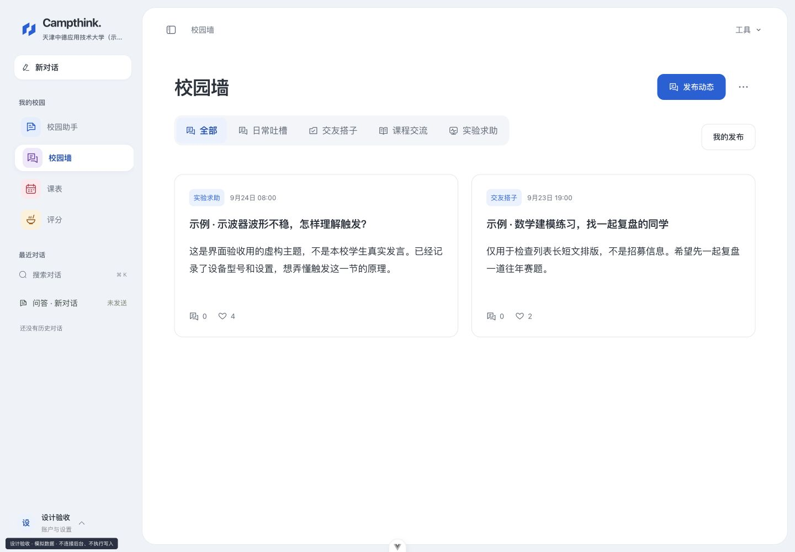
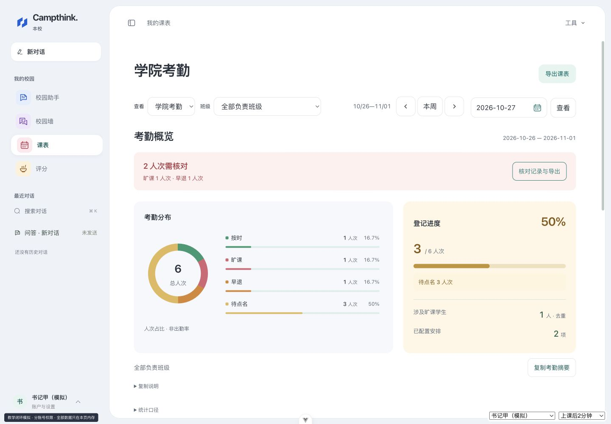
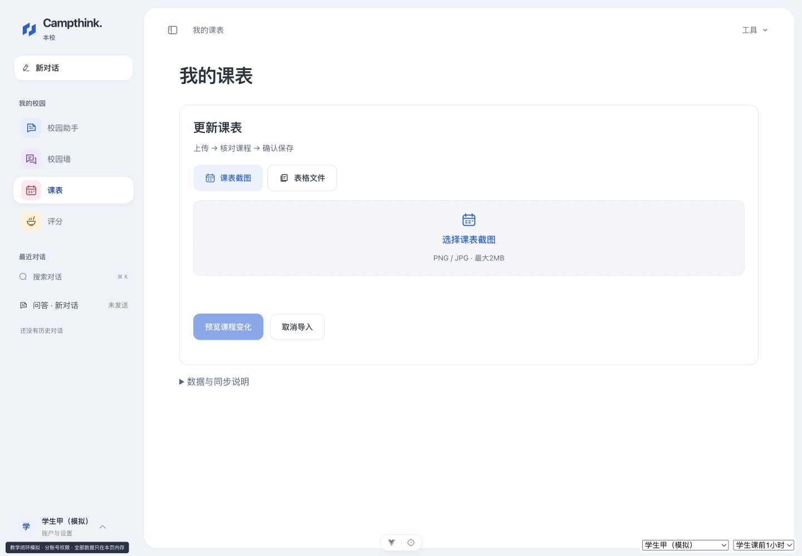
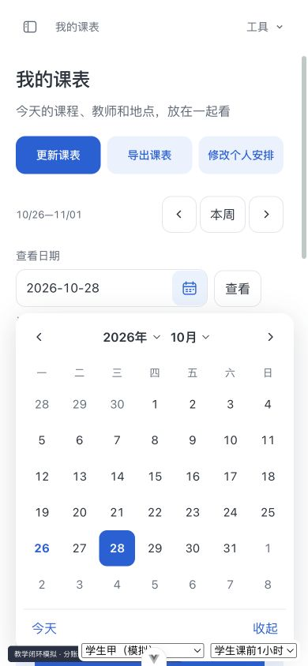

# Campthink · 校园 AI 与学习工作台

[](https://github.com/Jasp1rC0le/zhangweiqi/actions/workflows/ci.yml)

**线上站点：[campthink.cn](https://campthink.cn)（公测中）** · 面向天津中德应用技术大学 · Vue 3 + Spring Boot + MySQL

Campthink 是面向校园学习与日常事务的全栈应用：把带来源的校园问答、个人项目、资料整理和校园社区放在同一个工作台中。

> **先说清边界**：本仓库提供应用源码、测试、配置示例和部署工具。**源码中已实现的能力不等于已经公开上线**；真实数据导入、服务商配置、数据库迁移与生产环境验收需要由运营者完成。正式教学、真实身份和名单管理需要独立的学校授权与受控启用；开发演示中的合成角色不代表已接入学校系统。

| 你想做什么 | 去哪里 |
| --- | --- |
| 直接体验 | [campthink.cn](https://campthink.cn) |
| 本地把项目跑起来 | [本地开发与部署说明](docs/development.md) |
| 查全部文档 | [文档索引](docs/README.md) |
| 参与开发 | [贡献指南](CONTRIBUTING.md) |
| 了解安全与数据边界 | [安全说明](SECURITY.md) |

## 界面预览

以下为本地合成场景，非真实学生课程或发言。



<details>
<summary>更多界面预览（均为合成场景）</summary>





<p> </p>

</details>

历次界面改动的说明见[易用性更新](docs/usability-2026-10-26.md)、[2026-10-27 更新](docs/visual-rework-2026-10-27.md)与[配色与统计更新](docs/color-and-statistics-2026-10-27.md)。最新版本：课表截图上传后由后台本地 OCR 识别，校园墙只需一个正文框，见[运行和验证说明](docs/local-timetable-ocr.md)。

## 项目重点

- **有来源的回答**：资料先核读和审核，检索、引用及历史版本分别保留；用户反馈经核实后修订，不直接成为校园事实。
- **能完成任务的课表**：统一授权查询、自然语言日期追问、任课教师字段、图片识别核对、差异预览和明确确认保存。课程事实来自数据库，模型不直接执行 SQL。
- **实际操作的连续性**：首页今天/下一节、指定日期直达、单节复制，以及统计、记录、导出之间的日期与班级条件传递；切号、撤权和迟到响应有独立保护。
- **可控的模型调用**：SSE 流式输出、并发准入、有限重试与熔断、额度预留结算及预算控制；缺少用量或单价时不把费用显示为零。

## 已实现的能力

| 模块 | 当前源码能力 |
| --- | --- |
| 校园 AI | 多供应商模型选择、流式回答、会话历史、校园知识来源展示、回答反馈，以及可选联网搜索 |
| 知识管理 | 文件与受信官网链接预览、人工审核、批量导入、资料修订与下架、版本追溯、检索评测；可选语义检索与重排 |
| 项目工作室 | 私有项目与版本、任务清单、材料关联、缺项检查、导出，以及指定同校账号的版本审阅 |
| 学习工具 | 浏览器内提取 PDF/DOCX/XLSX 文本、CSV 结构与描述统计、有限公式复算及结果差异检查、仪器资料入口 |
| 我的课表 | 账号私有的课表图片与课程表格、导入预览及差异确认、周次覆盖、下一节课提示、核对提醒、下载与账户导出 |
| 校园社区 | 校园墙发布、审核、举报与撤回；食堂和商家维护、学生评分与评论审核 |
| 账号与隐私 | 注册登录、访问令牌与 HttpOnly 刷新 Cookie、会话管理、邮箱验证与找回、个人资料、数据导出和注销 |
| 管理与运营 | 同校权限隔离、资料与岗位管理、后台任务、模型用量、Token 额度、费用估算与平台预算保护 |

校园事实回答依赖已核实的资料。模型输出、描述统计和规则检查都不能代替事实核验、学校正式通知或专业判断。文件提取不包含通用 OCR 或原版式保真；支付、会员权益和实时共同编辑尚未实现。

个人导入课表只保存用户主动提供的内容，不收集教务密码，不自动登录学校或实时同步调课。课表截图由后台本地 OCR 识别并自动保存，按已提供的八节作息匹配钟点与节次，不发送给大模型；单周图片只更新明确周次，不自动补全整学期。表格文件仍保留原预览确认流程。详见[自动导入与作息映射](docs/timetable-auto-import-2026-10-27.md)、[本地截图识别](docs/local-timetable-ocr.md)与[私有课表说明](docs/private-timetable.md)。

## 技术栈

- **前端**：Vue 3、Vite、Vue Router、Pinia、Element Plus；Markdown 展示使用清理后的 HTML，附件解析在浏览器内执行。
- **后端**：Java 17、Spring Boot 4、MyBatis、MySQL；JWT 会话、SMTP 邮件、Apache Tika 文件文本提取。
- **验证**：JUnit / Spring Boot Test / H2、Node 内置测试、ESLint，以及独立部署脚本测试。
- **部署工具**：Caddy 反向代理与 HTTPS 配置、systemd 服务、数据库迁移、备份恢复及费用对账脚本。

具体依赖版本以 [pom.xml](campus-ai-server/pom.xml) 和 [package.json](campus-ai-web/package.json) / 锁文件为准。

## 目录结构

```text
campus-ai-server/           Spring Boot 服务与后端测试
  src/main/java/com/campusai/
    ai/                    模型调用、用量与预算
    controller/            HTTP API
    knowledge/             知识导入、版本与检索
    project/               私有项目与协作审阅
    security/              会话、权限和安全边界
    timetable/             私有课表图片与结构化课程
    canteen/ career/ wall/  校园业务模块
  src/main/resources/      配置、MyBatis 映射、当前数据库结构
campus-ai-web/              Vue 界面、工具函数与前端测试
  src/                     页面、组件、API、状态及工具
  design/                  开发环境的隔离演示数据与页面
deploy/                    配置示例、迁移、构建和运维工具
docs/                      开发、产品、验收边界与运行说明
database/schema.sql        早期数据库结构，仅供历史参考
```

当前完整建表文件是[服务端 schema.sql](campus-ai-server/src/main/resources/schema.sql)。不要使用 `database/schema.sql` 初始化当前版本。

## 快速开始

完整步骤（建库、环境变量全表、检查与构建、部署与限制）见[本地开发与部署说明](docs/development.md)，这里只列主线：

1. 准备 JDK 17、Maven 3.9、Node.js `^22.18.0` 或 `>=24.12.0`、MySQL 8+，并建立独立开发库 `campus_ai_dev`（不要把开发配置指向生产库）。
2. 在仓库根目录使用 Bash 复制开发配置模板，填写 `DB_USERNAME`、`DB_PASSWORD` 与 `JWT_SECRET`，不要提交实际 `.env`。JWT 密钥须为至少 32 字节随机数据的 Base64 编码，可用 `openssl rand -base64 32` 生成：

   ```bash
   umask 077
   cp deploy/development.env.example .env
   ```

   根目录 `.env` 按 Bash 语法读取：用 `NAME='值'` 赋值，等号两侧不加空格，避免密码中的空格或 `# Campthink · 校园 AI 与学习工作台

[](https://github.com/Jasp1rC0le/zhangweiqi/actions/workflows/ci.yml)

**线上站点：[campthink.cn](https://campthink.cn)（公测中）** · 面向天津中德应用技术大学 · Vue 3 + Spring Boot + MySQL

Campthink 是面向校园学习与日常事务的全栈应用：把带来源的校园问答、个人项目、资料整理和校园社区放在同一个工作台中。

> **先说清边界**：本仓库提供应用源码、测试、配置示例和部署工具。**源码中已实现的能力不等于已经公开上线**；真实数据导入、服务商配置、数据库迁移与生产环境验收需要由运营者完成。正式教学、真实身份和名单管理需要独立的学校授权与受控启用；开发演示中的合成角色不代表已接入学校系统。

| 你想做什么 | 去哪里 |
| --- | --- |
| 直接体验 | [campthink.cn](https://campthink.cn) |
| 本地把项目跑起来 | [本地开发与部署说明](docs/development.md) |
| 查全部文档 | [文档索引](docs/README.md) |
| 参与开发 | [贡献指南](CONTRIBUTING.md) |
| 了解安全与数据边界 | [安全说明](SECURITY.md) |

## 界面预览

以下为本地合成场景，非真实学生课程或发言。


<details>
<summary>更多界面预览（均为合成场景）</summary>


<p> </p>

</details>

历次界面改动的说明见[易用性更新](docs/usability-2026-10-26.md)、[2026-10-27 更新](docs/visual-rework-2026-10-27.md)与[配色与统计更新](docs/color-and-statistics-2026-10-27.md)。最新版本：课表截图上传后由后台本地 OCR 识别，校园墙只需一个正文框，见[运行和验证说明](docs/local-timetable-ocr.md)。

## 项目重点

- **有来源的回答**：资料先核读和审核，检索、引用及历史版本分别保留；用户反馈经核实后修订，不直接成为校园事实。
- **能完成任务的课表**：统一授权查询、自然语言日期追问、任课教师字段、图片识别核对、差异预览和明确确认保存。课程事实来自数据库，模型不直接执行 SQL。
- **实际操作的连续性**：首页今天/下一节、指定日期直达、单节复制，以及统计、记录、导出之间的日期与班级条件传递；切号、撤权和迟到响应有独立保护。
- **可控的模型调用**：SSE 流式输出、并发准入、有限重试与熔断、额度预留结算及预算控制；缺少用量或单价时不把费用显示为零。

## 已实现的能力

| 模块 | 当前源码能力 |
| --- | --- |
| 校园 AI | 多供应商模型选择、流式回答、会话历史、校园知识来源展示、回答反馈，以及可选联网搜索 |
| 知识管理 | 文件与受信官网链接预览、人工审核、批量导入、资料修订与下架、版本追溯、检索评测；可选语义检索与重排 |
| 项目工作室 | 私有项目与版本、任务清单、材料关联、缺项检查、导出，以及指定同校账号的版本审阅 |
| 学习工具 | 浏览器内提取 PDF/DOCX/XLSX 文本、CSV 结构与描述统计、有限公式复算及结果差异检查、仪器资料入口 |
| 我的课表 | 账号私有的课表图片与课程表格、导入预览及差异确认、周次覆盖、下一节课提示、核对提醒、下载与账户导出 |
| 校园社区 | 校园墙发布、审核、举报与撤回；食堂和商家维护、学生评分与评论审核 |
| 账号与隐私 | 注册登录、访问令牌与 HttpOnly 刷新 Cookie、会话管理、邮箱验证与找回、个人资料、数据导出和注销 |
| 管理与运营 | 同校权限隔离、资料与岗位管理、后台任务、模型用量、Token 额度、费用估算与平台预算保护 |

校园事实回答依赖已核实的资料。模型输出、描述统计和规则检查都不能代替事实核验、学校正式通知或专业判断。文件提取不包含通用 OCR 或原版式保真；支付、会员权益和实时共同编辑尚未实现。

个人导入课表只保存用户主动提供的内容，不收集教务密码，不自动登录学校或实时同步调课。课表截图由后台本地 OCR 识别并自动保存，按已提供的八节作息匹配钟点与节次，不发送给大模型；单周图片只更新明确周次，不自动补全整学期。表格文件仍保留原预览确认流程。详见[自动导入与作息映射](docs/timetable-auto-import-2026-10-27.md)、[本地截图识别](docs/local-timetable-ocr.md)与[私有课表说明](docs/private-timetable.md)。

## 技术栈

- **前端**：Vue 3、Vite、Vue Router、Pinia、Element Plus；Markdown 展示使用清理后的 HTML，附件解析在浏览器内执行。
- **后端**：Java 17、Spring Boot 4、MyBatis、MySQL；JWT 会话、SMTP 邮件、Apache Tika 文件文本提取。
- **验证**：JUnit / Spring Boot Test / H2、Node 内置测试、ESLint，以及独立部署脚本测试。
- **部署工具**：Caddy 反向代理与 HTTPS 配置、systemd 服务、数据库迁移、备份恢复及费用对账脚本。

具体依赖版本以 [pom.xml](campus-ai-server/pom.xml) 和 [package.json](campus-ai-web/package.json) / 锁文件为准。

## 目录结构

```text
campus-ai-server/           Spring Boot 服务与后端测试
  src/main/java/com/campusai/
    ai/                    模型调用、用量与预算
    controller/            HTTP API
    knowledge/             知识导入、版本与检索
    project/               私有项目与协作审阅
    security/              会话、权限和安全边界
    timetable/             私有课表图片与结构化课程
    canteen/ career/ wall/  校园业务模块
  src/main/resources/      配置、MyBatis 映射、当前数据库结构
campus-ai-web/              Vue 界面、工具函数与前端测试
  src/                     页面、组件、API、状态及工具
  design/                  开发环境的隔离演示数据与页面
deploy/                    配置示例、迁移、构建和运维工具
docs/                      开发、产品、验收边界与运行说明
database/schema.sql        早期数据库结构，仅供历史参考
```

当前完整建表文件是[服务端 schema.sql](campus-ai-server/src/main/resources/schema.sql)。不要使用 `database/schema.sql` 初始化当前版本。

## 快速开始

完整步骤（建库、环境变量全表、检查与构建、部署与限制）见[本地开发与部署说明](docs/development.md)，这里只列主线：

1. 准备 JDK 17、Maven 3.9、Node.js `^22.18.0` 或 `>=24.12.0`、MySQL 8+，并建立独立开发库 `campus_ai_dev`（不要把开发配置指向生产库）。
2. 在仓库根目录使用 Bash 复制开发配置模板，填写 `DB_USERNAME`、`DB_PASSWORD` 与 `JWT_SECRET`，不要提交实际 `.env`。JWT 密钥须为至少 32 字节随机数据的 Base64 编码，可用 `openssl rand -base64 32` 生成：

   ```bash
   umask 077
   cp deploy/development.env.example .env
   ```

 被错误解释；值含单引号时按[详细赋值说明](docs/development.md#3-配置并启动后端)转义。只加载自己创建并检查过的文件；已有配置不要用模板覆盖。

3. 在同一终端、仓库根目录加载自己创建并信任的 `.env` 后启动后端。Spring Boot 不会自动读取该文件；每次新开后端终端都需重新加载（默认 `http://localhost:8080`，`/api/health` 存活、`/api/health/ready` 就绪）：

   ```bash
   set -a
   source .env
   set +a
   cd campus-ai-server
   mvn spring-boot:run
   ```

4. 另开终端，先进入仓库根目录，再启动前端（默认 `http://localhost:5173`）：

   ```bash
   cd campus-ai-web
   cp .env.example .env.development
   printf '\nVITE_API_BASE_URL=http://localhost:8080\n' >> .env.development
   npm ci
   npm run dev
   ```

前端配置复制仅用于首次设置；已有 `.env.development` 时直接编辑。`VITE_API_BASE_URL` 指向后端，不加 `/api` 后缀；不要把后端密钥放入前端配置。

注册即创建普通用户。仓库不提供管理员默认密码或自动提权入口；邮箱验证与密码找回需要配置可用 SMTP；模型 API Key 为可选项，未配置的模型不可用于真实生成。

## 文档地图

- [文档索引](docs/README.md)：全部开发、产品与验收文档的入口
- [本地开发与部署说明](docs/development.md)：本地开发、环境变量、检查构建、部署限制
- [产品定位与约束](PRODUCT.md)与[设计记录](DESIGN.md)：按日期持续追加的产品决定与设计过程，是历史记录，不是入门文档
- [运行手册](docs/free-launch-runbook.md)与[发布检查表](docs/launch-readiness.md)：部署与上线前核对

## 授权

仓库未新增开源许可证；使用、转载代码或校园图片前应确认相应授权。
