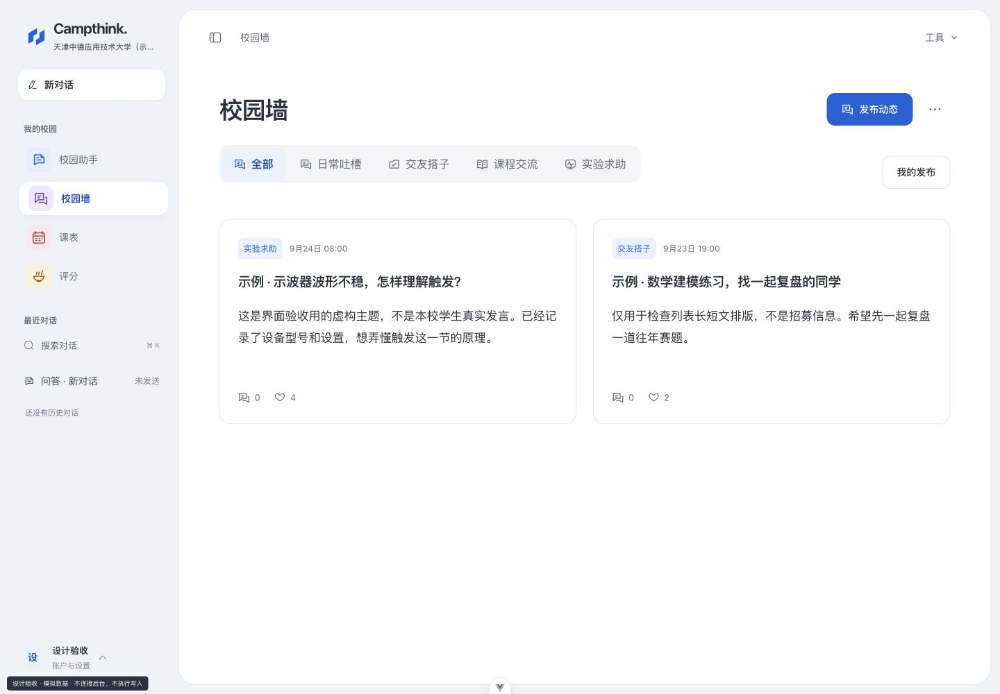
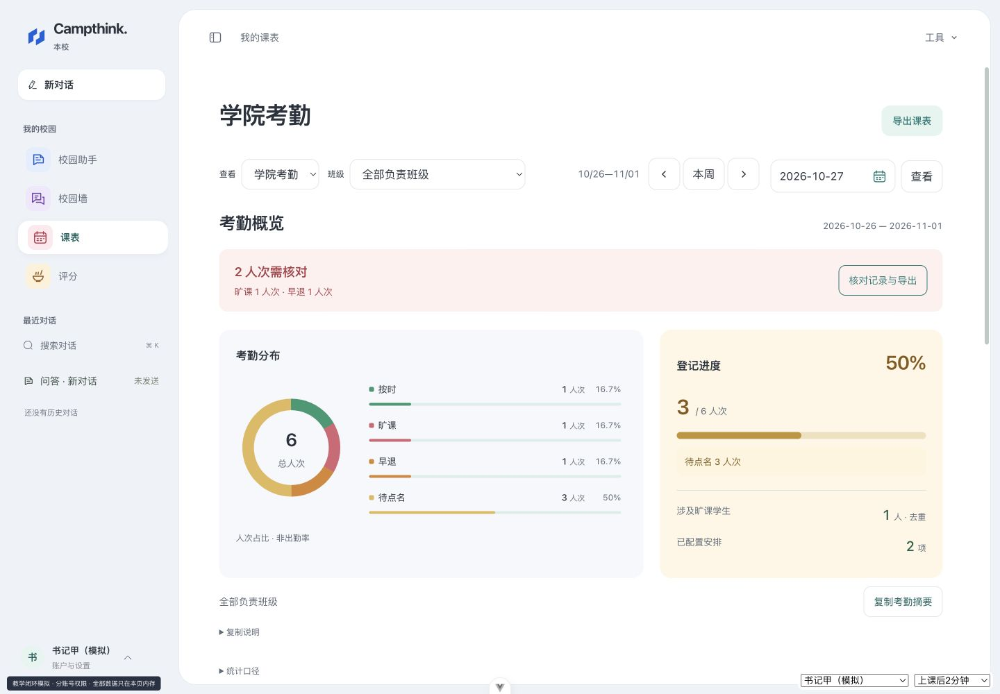
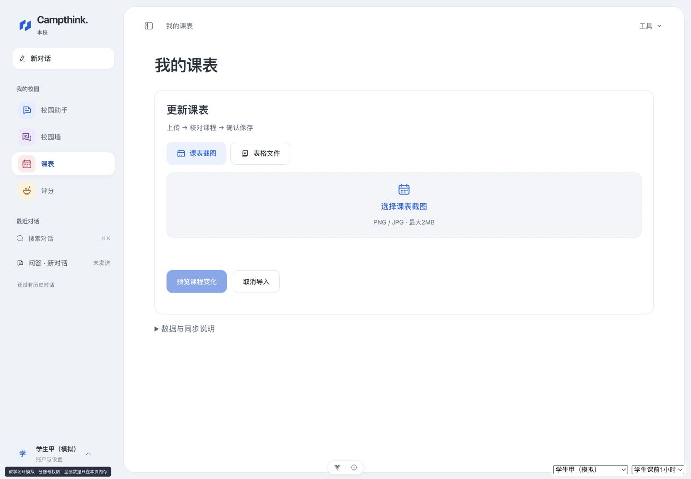
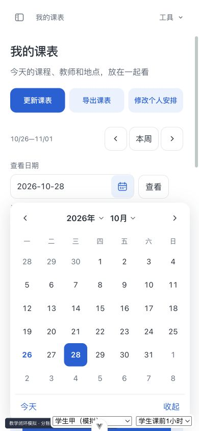

# Campthink · 校园 AI 与学习工作台

Campthink 是面向校园学习与日常事务的全栈应用：把带来源的校园问答、个人项目、资料整理和校园社区放在同一个工作台中。项目使用 Vue 3、Spring Boot 和 MySQL，当前内置学校配置面向天津中德应用技术大学。

本仓库提供应用源码、测试、配置示例和部署工具。**源码中已实现的能力不等于已经公开上线**；真实数据导入、服务商配置、数据库迁移与生产环境验收需要由运营者完成。

[开发指南](#本地开发) · [验证方式](#检查与构建) · [文档索引](docs/README.md) · [贡献指南](CONTRIBUTING.md) · [安全说明](SECURITY.md)

## 项目重点

- **有来源的回答**：资料先核读和审核，检索、引用及历史版本分别保留；用户反馈经核实后修订，不直接成为校园事实。
- **能完成任务的课表**：统一授权查询、自然语言日期追问、任课教师字段、图片识别核对、差异预览和明确确认保存。课程事实来自数据库，模型不直接执行 SQL。
- **实际操作的连续性**：首页今天/下一节、指定日期直达、单节复制，以及统计、记录、导出之间的日期与班级条件传递；切号、撤权和迟到响应有独立保护。
- **可控的模型调用**：SSE 流式输出、并发准入、有限重试与熔断、额度预留结算及预算控制；缺少用量或单价时不把费用显示为零。

正式教学、真实身份和名单管理需要独立的学校授权与受控启用；开发演示中的合成角色不代表已接入学校系统。

## 界面预览

以下为本地合成场景，非真实学生课程或发言。日期、截图导入与校园墙的改动见[易用性更新](docs/usability-2026-10-26.md)。

最新版本：截图上传后由后台本地 OCR 识别，校园墙只需一个正文框。见[运行和验证说明](docs/local-timetable-ocr.md)。



右上角发布入口、课表紧凑工具栏和模式切换排版见[2026-10-27 更新](docs/visual-rework-2026-10-27.md)。

食堂评分与领导端统计增加舒适的任务配色、状态图形并精简说明，见[配色与统计更新](docs/color-and-statistics-2026-10-27.md)。下图为合成验收数据。





<p> </p>

## 已实现的能力

| 模块 | 当前源码能力 |
| --- | --- |
| 校园 AI | 多供应商模型选择、流式回答、会话历史、校园知识来源展示、回答反馈，以及可选联网搜索 |
| 知识管理 | 文件与受信官网链接预览、人工审核、批量导入、资料修订与下架、版本追溯、检索评测；可选语义检索与重排 |
| 项目工作室 | 私有项目与版本、任务清单、材料关联、缺项检查、导出，以及指定同校账号的版本审阅 |
| 学习工具 | 浏览器内提取 PDF/DOCX/XLSX 文本、CSV 结构与描述统计、有限公式复算及结果差异检查、仪器资料入口 |
| 我的课表 | 账号私有的课表图片与课程表格、导入预览及差异确认、周次覆盖、下一节课提示、核对提醒、下载与账户导出 |
| 校园社区 | 校园墙发布、审核、举报与撤回；食堂和商家维护、学生评分与评论审核 |
| 账号与隐私 | 注册登录、访问令牌与 HttpOnly 刷新 Cookie、会话管理、邮箱验证与找回、个人资料、数据导出和注销 |
| 管理与运营 | 同校权限隔离、资料与岗位管理、后台任务、模型用量、Token 额度、费用估算与平台预算保护 |

校园事实回答依赖已核实的资料。模型输出、描述统计和规则检查都不能代替事实核验、学校正式通知或专业判断。文件提取不包含通用 OCR 或原版式保真；支付、会员权益和实时共同编辑尚未实现。

个人导入课表只保存用户主动提供并确认的内容，不收集教务密码，不自动登录学校或实时同步调课。课表截图由后台本地 OCR 识别，不发送给大模型；单周图片只更新明确周次，不自动补全整学期。课程表格支持明确列名的 UTF-8 CSV/TSV/TXT 或粘贴文本。详见[本地截图识别](docs/local-timetable-ocr.md)与[私有课表说明](docs/private-timetable.md)。

## 技术栈

- **前端**：Vue 3、Vite、Vue Router、Pinia、Element Plus；Markdown 展示使用清理后的 HTML，附件解析在浏览器内执行。
- **后端**：Java 17、Spring Boot 4、MyBatis、MySQL；JWT 会话、SMTP 邮件、Apache Tika 文件文本提取。
- **验证**：JUnit / Spring Boot Test / H2、Node 内置测试、ESLint，以及独立部署脚本测试。
- **部署工具**：Caddy 反向代理与 HTTPS 配置、systemd 服务、数据库迁移、备份恢复及费用对账脚本。

具体依赖版本以 [pom.xml](campus-ai-server/pom.xml) 和 [package.json](campus-ai-web/package.json) / 锁文件为准。

## 目录结构

```text
campus-ai-server/           Spring Boot 服务与后端测试
  src/main/java/com/campusai/
    ai/                    模型调用、用量与预算
    controller/            HTTP API
    knowledge/             知识导入、版本与检索
    project/               私有项目与协作审阅
    security/              会话、权限和安全边界
    timetable/             私有课表图片与结构化课程
    canteen/ career/ wall/  校园业务模块
  src/main/resources/      配置、MyBatis 映射、当前数据库结构
campus-ai-web/              Vue 界面、工具函数与前端测试
  src/                     页面、组件、API、状态及工具
  design/                  开发环境的隔离演示数据与页面
deploy/                    配置示例、迁移、构建和运维工具
docs/                      开发、产品、验收边界与运行说明
database/schema.sql        早期数据库结构，仅供历史参考
```

当前完整建表文件是 [服务端 schema.sql](campus-ai-server/src/main/resources/schema.sql)。不要使用 `database/schema.sql` 初始化当前版本。

## 本地开发

### 1. 准备依赖

- JDK 17 或兼容版本、Maven 3.9 系列。
- Node.js `^22.18.0` 或 `>=24.12.0`，以及 npm（与前端 `engines` 声明一致）。
- MySQL，建议使用独立的 MySQL 8+ 开发库。
- 模型 API Key 为可选项；未配置的模型不可用于真实生成。

```bash
git clone https://github.com/Jasp1rC0le/zhangweiqi.git
cd zhangweiqi
```

### 2. 建立独立开发库

通过本机 MySQL 管理客户端执行：

```sql
CREATE DATABASE campus_ai_dev
  CHARACTER SET utf8mb4 COLLATE utf8mb4_unicode_ci;
```

为该库设置专用开发账号，并授予开发所需的建表、索引和读写权限。不要把开发配置指向现有生产库。普通开发配置会在启动时执行当前 `schema.sql`，也会运行部分初始化逻辑；`prod` 配置关闭自动建表，生产升级必须单独审查迁移。

### 3. 配置并启动后端

```bash
umask 077
cp deploy/development.env.example .env
```

编辑本机 `.env`，填写 `DB_USERNAME`、`DB_PASSWORD` 与 `JWT_SECRET`。JWT 密钥必须是至少 32 字节随机数据的 Base64 编码，可以用本机 `openssl rand -base64 32` 生成后填入。可按需填写模型 Key；不要提交实际 `.env`。

```bash
# 在仓库根目录执行；只加载自己创建并信任的本机配置。
set -a
source .env
set +a
cd campus-ai-server
mvn spring-boot:run
```

后端默认地址为 `http://localhost:8080`。`/api/health` 表示进程存活；`/api/health/ready` 会连接当前数据库并检查必要业务表，缺表或连接失败返回 503。已有数据库升级需审查[私有课表增量迁移](deploy/migrations/2026-10-11-private-timetables.sql)，它新增四张表，不应以完整建表脚本覆盖旧库。

### 4. 启动前端

另开一个终端，在仓库根目录执行：

```bash
cd campus-ai-web
cp .env.example .env.development
npm ci
npm run dev
```

访问 Vite 输出的本机地址，默认是 `http://localhost:5173`。前后端本机配置应使用相同的主机名；修改端口时同步调整 `CORS_ALLOWED_ORIGINS`、`PUBLIC_WEB_URL` 与 `VITE_API_BASE_URL`。

注册创建普通用户。仓库不提供管理员默认密码或自动提权入口；管理功能需要运营者通过受控流程设置已有账号角色。邮箱验证与密码找回需要配置可用 SMTP。

开发预览入口 `/design-review.html?page=projects` 使用隔离演示数据，不能作为真实数据持久化或生产联调通过的证据。

## 环境变量

本地开发使用 [开发模板](deploy/development.env.example)；仓库根目录 [生产模板](.env.example) 是 **`prod,free` 生产候选模板**，不能直接当作本机开发配置。Spring Boot 不会自动读取根目录 `.env`，需要由启动终端、IDE 或服务管理器注入。

| 分类 | 主要变量 | 说明 |
| --- | --- | --- |
| 数据库 | `DB_HOST`、`DB_PORT`、`DB_NAME`、`DB_USERNAME`、`DB_PASSWORD` | 指向专用库；生产禁止空密码和 root 账号 |
| 会话 | `JWT_SECRET`、`AUTH_SECURE_COOKIES` | JWT 密钥必填；正式 HTTPS 环境使用安全 Cookie |
| 来源 | `CORS_ALLOWED_ORIGINS`、`PUBLIC_WEB_URL` | 与浏览器真实访问地址一致 |
| 模型 | `DEEPSEEK_API_KEY`、`KIMI_API_KEY`、`GLM_API_KEY` | 仅在后端设置；模型与接口地址可通过对应变量覆盖 |
| 额度与预算 | `AI_DAILY_TOKEN_LIMIT`、`AI_MAX_CONCURRENT`、`AI_PLATFORM_DAILY_CNY`、`AI_PLATFORM_MONTHLY_CNY` | 开发默认用户额度 60000 Token，生产默认 20000；活跃管理员豁免账号日额度，但仍记录使用并受平台费用和并发保护 |
| 可选检索 | `BOCHA_API_KEY`、`WEB_SEARCH_ENABLED`、`KNOWLEDGE_SEMANTIC_API_KEY`、`KNOWLEDGE_SEMANTIC_ENABLED`、`KNOWLEDGE_RERANK_ENABLED` | 启用外部服务可能产生费用；`free` 配置关闭这些额外检索能力 |
| 邮件与反馈 | `SMTP_*`、`CONTACT_RECIPIENT_EMAIL`、`CONTACT_SCHOOL_ID` | 邮箱功能需要真实配置；访客反馈学校为 0 时禁用访客提交 |
| 生产隐私配置 | `PRIVACY_POLICY_APPROVED`、`PRIVACY_OPERATOR_NAME`、`PRIVACY_CONTACT_EMAIL` 等 | 必须根据实际主体、第三方和留存政策审查后填写 |
| 前端公开配置 | `VITE_API_BASE_URL`、`VITE_PUBLIC_OPERATOR`、`VITE_ICP_FILING`、`VITE_PSB_FILING` | `VITE_` 值会进入浏览器构建，不能放任何秘密 |

费用估算依赖运营者维护模型单价；模板中的价格是历史配置示例，需要按供应商当前账单口径核对，应用预算不等于供应商最终账单或硬性计费上限。

## 检查与构建

以下命令与仓库现有测试和构建入口对应：

```bash
# 仓库根目录：部署脚本的单元回归
node --test --test-timeout=15000 deploy/*.test.mjs

# 后端：测试并生成 JAR
cd campus-ai-server
mvn verify
cd ..

# 前端：安装锁定依赖、单元回归、只读 lint、生产构建
cd campus-ai-web
npm ci
npm test
npx eslint src
npm run build
```

`npm run lint` 包含自动修复选项；仅审查代码时使用上面的 `npx eslint src`。`UserMapperTest` 只有显式设置 `RUN_MYSQL_INTEGRATION_TESTS=true` 才连接真实数据库；不要在不清楚目标库时打开它。

前端产物位于 `campus-ai-web/dist/`，后端产物位于 `campus-ai-server/target/`，均不入库。`bash deploy/build-release.sh` 可生成本机候选发布包；它会重新安装前端依赖并运行验证，**不会自动部署服务器**。

## 部署与当前限制

部署前阅读 [运行手册](docs/free-launch-runbook.md) 与 [发布检查表](docs/launch-readiness.md)。仓库提供 Caddy、systemd、迁移、备份与恢复脚本；生产数据库升级、域名、HTTPS、邮件、隐私说明及所需资质都需要在目标环境单独确认。

- 生产使用 `prod,free` 时关闭自动建表；先按目标数据库版本审查完整结构和增量迁移，已有数据不得直接用空库流程覆盖。
- AI 供应商、SMTP、公网 HTTPS、付费调用、异机恢复及真实账号流程需要专门验收；本地测试通过不能代替这些验证。
- 当前语义向量存于 MySQL，并由 Java 计算相似度；规模增长时需要重新评估检索实现。进程内并发限制和熔断也需要在多实例部署时调整。
- 研究原件、内部招生材料、真实账号截图、导入回执、SQLite 资料库和个人运行脚本保留在维护者本机，不属于本源码发布。应用不依赖这些文件启动。
- 仓库未新增开源许可证；使用、转载代码或校园图片前应确认相应授权。

进一步了解实现与历史验收边界，请从 [文档索引](docs/README.md) 开始。
